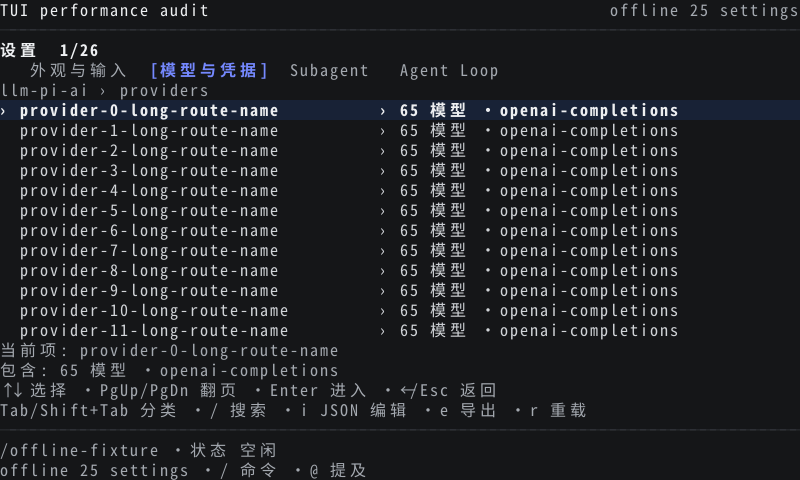
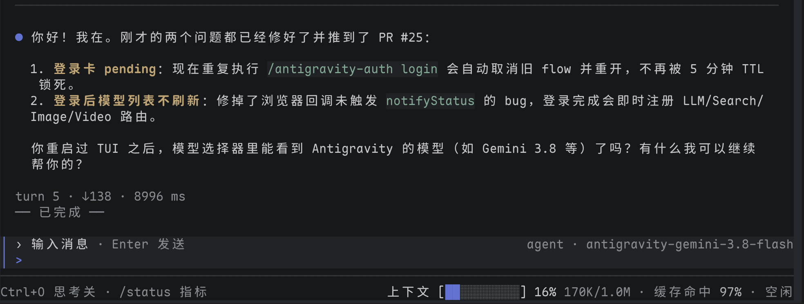

# dsh-tui — DeepSeek Harness 终端界面

[English](README.md) | 中文

[](https://github.com/zhangyang-crazy-one/dsh-tui/actions/workflows/ci.yml)
[](https://github.com/zhangyang-crazy-one/dsh-tui/releases)
[](https://www.npmjs.com/package/@crazyhappyone/dsh-tui)

## 概述

`@crazyhappyone/dsh-tui` 是 DeepSeek Harness（dsh）的终端界面，以 dsh **插件 bundle** 加 `dsh-tui` launcher 的形式发布。包声明了 `dsh.bundle`，因此 dsh 会像安装其他插件一样把它装进 profile；launcher 只负责自动完成这一安装并启动 profile。本仓库拥有插件源码（`tui/`、`tui-render/`）。Agent、会话、工具、持久化、provider、权限与 profile 组装仍由 DSH 拥有。

## 0.1.0-alpha.51 版本

本预发布版面向 DSH `0.2.1-rc.2`，修复实时输出穿插到输入区、滚轮逐行追赶，减少历史渲染开销，并加入设置多级导航。同时修复失败流式文本残留、SSH 登录提示和 `/cd` 后的文件路径问题（#14–#16）。完整变更与验证边界见 [changelog](CHANGELOG.md#010-alpha51--2026-10-21)。

```sh
npm install --global @crazyhappyone/dsh-tui@next
dsh-tui probe
dsh-tui
```

轻量模式和源码模式现在默认使用 `$DSH_HOME/profiles/`（通常为 `~/.dsh/profiles/`）下的官方 `deepseek-tui` profile。`/model` 读取 `ctx.llm`，模型选择调用 DSH 的 `agentDefaultModel`；本 bundle 不读取私有模型配置，也不复制其他 profile 的 provider。Magpie 会写入已有的 `profiles/*/cordis.patch.yml`；若在新 profile 创建前已接入 Magpie，创建后刷新其 DSH 接入/模型目录，再重启 TUI。

旧版轻量模式使用 `tui`，源码模式使用 `deepseek-tui`。两个目录均保留，不自动删除或迁移。继续使用原轻量 profile 可运行 `dsh-tui --profile tui`。使用其他已挂载 TUI 的官方 profile 时传入 `--profile NAME`；两种模式的安装和启动都会使用同一个指定目标。各 profile 仍由 DSH 独立配置；只写入 `web` 的 provider 不会自动变成全局配置。

正在运行的源码链接安装可通过 `/reload` 加载新构建，但会保留进程原先选中的 profile。若从 `tui` 切换到 `deepseek-tui`，需退出后重新启动，或显式指定 profile。恢复的 Goal 需执行 `/goal resume` 才会自动续跑。

`/settings` 现在支持多级浏览。Enter 进入分类、namespace、Provider、model 或字段；←/Esc 返回上一层；`/` 搜索；`i` 编辑对象 JSON；Space 切换支持的值。保存后停留当前位置，继续使用 DSH 官方 settings/credentials 服务。本次 PTY 对照中，9 行滚动到达目标从 168.07 ms 降至 17.93 ms；2,812 个有正文快照的比较帧未发现正文不一致或越界。这是合成数据的 PTY 实测，不是硬件延迟保证。数据与边界见[修复验证](docs/performance-audit-2026-10-21/fix-verification.md)。

## 目录

- [版本与升级](#010-alpha51-版本)
- [Changelog](CHANGELOG.md)
- [终端能力](#终端能力)
- [截图](#screenshots)
- [安装 launcher](#install-the-launcher)
- [运行与更新](#run-and-update)
- [配置源码运行时](#configure-the-source-runtime)
- [与 DSH 的关系](#relationship-to-dsh)
- [包](#packages)
- [开发工作流](#development-workflow)
- [发布 npm 包](#publish-the-npm-package)
- [已知限制](#known-limitations)
- [开发备注](#dev-note)

-----

<a id="screenshots"></a>
## 截图

交互式设置面板（`/settings`）：



发送 `你好` 后：



-----

<a id="install-the-launcher"></a>
## 安装 launcher 与运行模式

无 scope 的 `dsh-tui` 包属于另一位 maintainer。本项目只在已认证的 `crazyhappyone` npm scope 下发布。

`dsh-tui` 支持两种运行模式：

### 模式 A：轻量模式（推荐，零 Clone 秒开）
全局安装官方引擎与 TUI launcher：

```text
npm install --global @deepseek-ai/dsh
npm install --global @crazyhappyone/dsh-tui@next
dsh-tui probe
dsh-tui
```

首次启动会执行 `dsh plugin --profile deepseek-tui add <包目录>`，把本包链接进 `deepseek-tui` profile，排在 `@deepseek-ai/dsh-base` 之后；之后的启动检测到已安装，直接执行 `dsh --profile deepseek-tui`。不使用 launcher 时，也可以手动执行同样的两条 dsh 命令：

```text
dsh plugin --profile deepseek-tui add @crazyhappyone/dsh-tui@next
dsh --profile deepseek-tui
```

在 dsh 0.2 中以 bundle 方式安装是必需的：`/settings` 的修改写入 profile 自己的 patch 层，该层在 bundle 层之后生效；而 `--patch` overlay 位于 profile 层之后，dsh 会拒绝对此类 overlay 所拥有的行写入设置。

探测顺序为绝对路径 `DSH_BIN`、PATH、npm/pnpm 全局包、工作目录和 launcher 目录可解析的本地包；每个探测子进程限时十秒，以覆盖冷启动。显式 `DSH_BIN` 失败时不会选择其他安装。包内 bin 使用 launcher 的 Node 执行。

本 bundle 面向 dsh `0.2` 发布线（基于 `0.2.1-rc.2` 构建，并在 `0.2.1-alpha.2` 上验证）。包把 `@deepseek-ai/dsh` `>=0.2.0-rc.2 <0.3.0` 声明为可选 peer，因此手动安装时由 dsh 自身的插件兼容性检查把关；launcher 会拒绝其他引擎发布线并给出确切的安装命令，设置 `DSH_TUI_SKIP_ENGINE_CHECK=1` 可跳过 launcher 的检查。

### 模式 B：源码模式（开发者调试）
若需对 TUI 或 DSH 底层代码进行修改与调试：

```text
npm install --global @crazyhappyone/dsh-tui@next
dsh-tui update
dsh-tui --source
```

显式执行 `dsh-tui update` 才会通过 Git 克隆源码并执行 `pnpm install`。可通过 `dsh-tui probe` 查看当前探测到的运行引擎。

-----

<a id="run-and-update"></a>
## 运行与更新

初始化后，在希望 agent 使用的 workspace 中运行 `dsh-tui`：

```text
dsh-tui
```

需要刷新专用运行时时，请先运行 `dsh-tui update`，然后再次启动。

普通参数会原样传递给 `deepseek-tui` profile：

```text
dsh-tui "review this repository"
dsh-tui --resume <session-id>
dsh-tui --cwd <directory>
```

运行时不存在时，`dsh-tui update` 会 clone 配置的源码。对于现有运行时，它要求工作树干净、fetch 配置的 ref、证明当前 HEAD 是该 ref 的祖先、只应用 `git merge --ff-only`，再运行 `pnpm install --frozen-lockfile`。Dirty 或 divergent history 会在 HEAD 改变前停止。

`dsh-tui version` 会报告 launcher 版本、运行时目录、运行时 Git SHA 与 DSH 版本，并且不访问网络。精确单词 `update` 与 `version` 是 launcher 命令；使用 `dsh-tui -- update` 或 `dsh-tui -- version` 将其作为 TUI task 发送。

更新 launcher 与更新运行时是不同操作：

```text
npm install --global @crazyhappyone/dsh-tui@next
dsh-tui update
```

-----

<a id="configure-the-source-runtime"></a>
## 配置源码运行时

默认使用官方公开仓库的 `dsh-v0.2.1-rc.2` tag。源码模式会将本插件链接到现有 `deepseek-tui` profile，保留用户 patch；缺少 Typert 运行时产物时先调用上游生成器。随后通过 `pnpm exec node` 启动源码 CLI，不运行每次都会安装整个工作区的 `predsh` 钩子。

| 环境变量 | 默认值 | 用途 |
|---|---|---|
| `DSH_TUI_RUNTIME_DIR` | `~/.local/share/dsh-tui/runtime` | 仅供 launcher 使用的专用 clone |
| `DSH_TUI_SOURCE_URL` | `https://github.com/deepseek-ai/deepseek-harness.git` | `update` clone 和 fetch 的 Git remote |
| `DSH_TUI_SOURCE_REF` | `dsh-v0.2.1-rc.2` | `update` fetch 的 branch 或 ref |
| `DSH_TUI_PNPM` | `pnpm` | 安装和启动所用的 pnpm executable |

所有值都不得为空，运行时目录必须是绝对路径。Launcher 会拒绝 symbolic-link runtime path，也会拒绝不是 Git checkout 的现有目录。Child command 接收参数数组，不使用 shell interpolation。

如果 fast-forward 后的依赖刷新失败，运行时会停留在报告的新 SHA，但不会被声明为 ready。请运行 launcher 打印的精确恢复命令。对于 dirty 或 divergent 状态，只检查专用运行时目录，或选择新的空 `DSH_TUI_RUNTIME_DIR`；launcher 不会自动丢弃它。

-----

<a id="relationship-to-dsh"></a>
## 与 DSH 的关系

TUI 是 dsh 插件 bundle，不是 fork，也不是独立的 agent 运行时：

```text
@deepseek-ai/dsh-base                  dsh 核心 bundle（agent、会话、工具）
  └─ @crazyhappyone/dsh-tui             本 bundle：cordis.patch.yml + dist/*
       ├─ tui-startup  (./startup)      命令行 provider（任务、--resume、--cwd）
       ├─ tui          (./settings)     /settings 中可编辑的 TUI 偏好（volatile）
       ├─ tui-runtime  (./runtime)      终端生命周期与控制器
       ├─ schedule     (./schedule)     官方定时服务与共享会话激活
       └─ zen-proxy    (./zen-proxy)    可选的 OpenCode Zen 请求头代理
```

各行通过包的 `exports` 引用插件，因此设置修改会在 profile patch 中记录可移植的行名。本 bundle 还插入已发布的 dsh 插件 `session-stats`、`message-feedback`、`tool-ask-user`、`workspace-changes`、`tool-schedule`、`time-context`、`tool-present`，以及用于账号登录回调的回环 `webserver`，并覆盖 `system-prompt`、`tools`、`session-query-sqlite` 与 `session-title-llm`。

### 定时提醒与用户提问

模型可使用官方 `schedule_create`、`schedule_list`、`schedule_update`、`schedule_delete` 工具。`/schedules` 跨会话列出提醒：↑↓ 或 PgUp/PgDn 选择、Enter 查看完整提示词、再次 Enter 打开所属会话、`r` 刷新、`d` 请求取消确认（`y` 确认，`n` 或 Esc 保留）。切换到其他会话后，投递仍恢复原会话。任务跨重启持久化；计时器仅在当前进程运行时工作，关闭期间到期的任务在下次启动时处理。投递回执表示已持久写入 inbox，不表示模型已完成回答。适配层打包固定 DSH 构建版本的官方定时服务和会话激活助手；升级上游后需重跑集成检查。

用户提问支持整批逐题作答、多选和自定义文本。Space 切换多选项；`c` 打开自定义编辑器；Enter 保存文本、提交选项。无选项的问题直接进入编辑器。Tab 打开完整问题与回答供滚动阅读，Tab 或 Esc 返回编辑。编辑器内 Esc 丢弃本次编辑（纯文本问题则取消提问）；选项页 Esc 取消整次请求。粘贴的多行回答保留原文，不改变聊天草稿。

凭据编辑器及 `/key`、`/login` 的密钥参数显示圆点遮罩，凭据引用名保持可见。遮罩只影响显示：编辑和提交保留原值，取消后恢复聊天草稿。

### 时间上下文、交付文件与图片粘贴

官方 `time-context` 插件在准备模型步骤时提供当前时间和进程所在时区，十分钟后刷新。这类模型上下文不会增加人类对话中的消息行。

模型可用官方 `present` 工具显式交付现有文件，每次最多八个。`/deliveries` 列出当前会话已记录的交付文件：↑↓ 选择、Enter 预览 UTF-8 文本、`o` 请求本机系统应用打开所选文件、Esc 返回。PDF、Office、图片等二进制格式显示文件信息，并通过系统应用查看。文本读取默认限制为 1 MiB。已完成回合也会显示交付路径与说明；记录可随会话恢复，但文件必须仍存在且可访问。

剪贴板图片粘贴在 macOS 使用 `pngpaste -`（[安装：`brew install pngpaste`](https://github.com/jcsalterego/pngpaste)），Wayland 使用 `wl-paste`，X11 使用 `xclip`。缺少助手时显示明确错误；读取默认五秒超时，关闭 TUI 时取消，并保留既有图片大小限制与校验。macOS 命令和子进程行为已在 Linux 上自动验证，macOS 实机验证仍待完成。

### DeepSeek 账号、模型与工作目录

- 当 dsh 挂载 `deepseek-account` 服务时，`/login` 打开 DeepSeek 账号页：Enter 发起浏览器登录，`o` 重新打开授权链接，`c` 取消；登录后页面显示账号资料与余额。浏览器回调到本 bundle 的 `webserver` 行，监听 `127.0.0.1` 上由系统分配的端口。通过 SSH 使用时，页面显示 `ssh -L` 端口转发命令而不打开浏览器；在 `webserver` 行固定 `port` 可让转发保持稳定。关闭重开页面会继续已有登录并恢复转发提示；按 `o` 才显式打开链接。未挂载账号服务时，`/login` 与 `/key` 打开 API 密钥编辑器。
- `/logout` 确认后退出登录，已保存的 API 密钥保留。
- `/model` 在 `deepseek-account` 与 `deepseek-official` 目录为空时列出它们，并注明使模型可用的步骤（`/login` 或 `/key`），且拒绝选中此类行。
- `/cd [路径]` 在 dsh 0.2.1 及以后版本查看或切换会话工作目录。顶栏、`@` 提及与 `/files` 随之切换，文件面板输入的相对路径也以当前会话目录为基准；模型会收到变更通知；已有 shell 保留各自的目录。
- `/plugins` 将官方 bundle 单独分组。文件尚未安装的官方目录条目标记为可安装，按 Space 打开其精确安装目标的安装预览。

### OpenCode Zen 免费模型

打包后的 patch 挂载了 `zen-proxy`（vendored 自
[zhangyang-crazy-one/dsh-zen-proxy](https://github.com/zhangyang-crazy-one/dsh-zen-proxy)，
fork 自 [Yee-h/dsh-zen-proxy](https://github.com/Yee-h/dsh-zen-proxy)）：进程内 localhost
代理，注入 Zen 要求的 OpenCode 官方客户端头（`User-Agent`、
`x-opencode-client/session/request/project`）。没有它，Zen 会返回
`400 MissingSessionID` / `429 FreeUsageLimitError`，因为 dsh 始终发送自己的
attribution `User-Agent`。

使用方法：通过 TUI `/settings` provider 表单（或 profile 的 `cordis.patch.yml`）
添加一个指向该代理的 provider，并把密钥放在 credentials 中：

```yaml
- id: llm-pi-ai
  config:
    providers:
      opencode:
        api: openai-completions
        baseURL: http://127.0.0.1:4097/v1
        apiKeyEnv: OPENCODE_API_KEY
```

代理只监听 `127.0.0.1:4097`；在 profile 的 `cordis.patch.yml` 中加入 `- id: zen-proxy` 并设置 `disabled: true` 即可关闭。

-----

<a id="packages"></a>
## 包

| 包 | DSH 形态 | 职责 |
|---|---|---|
| [`tui/`](tui/README.zh.md) | 运行时、启动与设置插件 | 在 `dsh-base` 上组合终端层、拥有 live 终端会话，并将用户动作映射到 DSH 服务 |
| [`plugins/zen-proxy/`](https://github.com/zhangyang-crazy-one/dsh-zen-proxy) | Vendored 插件（打包为 `dist/zen-proxy.js`） | 进程内 OpenAI 兼容代理，注入 OpenCode Zen 客户端头；在 `cordis.patch.yml` 中挂载 |
| [`tui-render/`](tui-render/README.zh.md) | Library | 通过 Ink 投影控制器状态，但不拥有 agent、持久化或模型请求 |

-----

<a id="development-workflow"></a>
## 开发工作流

`tui/` 与 `tui-render/` 基于上游 dsh checkout 编译，版本为 `src/launcher.js` 中 `COMPATIBLE_DSH_VERSION` 指定的 tag：

```text
git clone --branch dsh-v0.2.1-rc.2 https://github.com/deepseek-ai/deepseek-harness ../deepseek-harness
(cd ../deepseek-harness && pnpm install)
npm run build          # 或 DSH_SOURCE=/path/to/checkout npm run build
(cd ../deepseek-harness && pnpm install) # 链接挂载后的插件开发依赖
npm run dev:setup      # 同样支持 DSH_SOURCE；生成类型声明并链接编辑器依赖
npm run typecheck      # 严格检查源码和测试
```

`npm run build` 把插件包与 `cordis.patch.yml` 复制进 checkout 的 `packages/tui/` workspace，用 esbuild 打包 `dist/index.js`、`dist/startup.js`、`dist/settings.js`、`dist/schedule.js` 与 `dist/zen-proxy.js`，并逐个检查导入。插件测试在 checkout 中运行 `npx vitest run packages/tui`，launcher 测试在本仓库运行 `npm test`；发布前运行 `npm run pack:check`。通过 packed tarball 或 `dsh plugin --profile <name> add <本目录>` 测试安装。

本地 `tsconfig.json` 用于独立插件仓库的编辑器检查；构建时使用 `tsconfig.workspace.json` 作为 checkout 中的包配置，保留上游项目引用。`dev:setup` 构建依赖类型声明并链接整个 `node_modules` 目录，保留 pnpm 的相对链接。更新上游或公开类型后重新执行 build 和 setup；编辑器若仍显示旧的缺失模块错误，需要重载 TypeScript 项目。

-----

<a id="publish-the-npm-package"></a>
## 发布 npm 包

GitHub Actions 会在每个 pull request 和向 `main` 的 push 上使用 Node 22.19 与 24 运行测试。只有发布 GitHub Release 才会启动 npm 发布。工作流要求 Release tag 等于 `v` 加 `package.json` 中的版本；prerelease 发布到 npm `next` tag，stable release 发布到 `latest`。

在 `publish.yml` 进入默认分支后，一次性配置 npm Trusted Publishing。npm CLI 11.5.1 或更高版本可以通过已认证的 browser session 注册 GitHub workflow。下面的命令会临时运行兼容的 npm 11，不替换全局安装的 npm：

```text
npx --yes npm@11 trust github @crazyhappyone/dsh-tui \
  --file publish.yml \
  --repository zhangyang-crazy-one/dsh-tui \
  --allow-publish
```

对应的 npm 网站配置为：organization or user 填 `zhangyang-crazy-one`，repository 填 `dsh-tui`，workflow filename 填 `publish.yml`，environment 留空。工作流使用 GitHub OIDC，不保存 npm token、密码或 OTP。

每次发布时，先提升 `package.json` 版本，等待 CI 通过并合并，然后创建 tag 与 package version 一致的 GitHub Release：

```text
gh release create v0.1.0-alpha.50 --prerelease --notes-file docs/releases/v0.1.0-alpha.50.md
```

`Publish npm` workflow 会在发布前再次运行测试与 packed-package 验证。不要重新运行旧的 release tag：npm version 不可覆盖。提升到 stable 必须使用新版本并发布 non-prerelease GitHub Release。

-----

## 终端能力

`/timeline` 浏览逐条 Session 事件、真实工具/token/时长与完整 JSON；`/attachments` 列出类型化图片/文件引用并打开本地副本；`/review` 读取逐文件官方 diff。`/files` 对已展开目录合并自动刷新，并保留手工 `r` 刷新。

`/settings` 使用 Tab/Shift+Tab 切换分组，持久化 `tui.theme=dark|light`。`/keys` 列出各场景按键；`/bind ACTION Ctrl+X`、`/bind ACTION default`、`/unbind ACTION` 修改输入区快捷键并检查冲突。Shift+方向键/Home/End 按字素选择，输入/粘贴替换选区，Ctrl+Y 复制普通选区；凭据选区禁止复制。审批、提问及计划评审中可用 Alt+H 打开只读帮助。

`/agents` 支持 `c` 续聊（Enter 排队、Ctrl+Enter 引导）、`s` 请求停止、`v` 在 100 列以上并排查看。窄终端保留单面板。人工控制保留目录给出的准确直接父会话地址；Stop 回执不表示执行已经停止。

`/preset` 浏览 standard/PTC/minimal/cordis 声明，`/preset ID` 在首轮前选择隔离组合；开始对话后保持锁定。`/market QUERY` 检索已配置索引，`i` 进入插件管理器预览及确认，`n/p` 翻页。`/inspect` 浏览官方 Host provider，`/inspect host PROVIDER METHOD JSON` 查询具体契约。`/focus` 隐藏中间工具卡片，不修改模型工具或会话日志。外部语言包可调用 `registerTuiLocale`；围栏代码采用有界的按语言词法高亮。

Goal 页脚区分自动续跑和需要 `/goal resume` 恢复的停止状态。后台开启的回合会更新运行状态及 Ctrl+C 取消路径。更新正在运行的源码安装后使用 `/reload`；恢复的 Goal 需显式 `/goal resume` 重新授权续跑。

验证及平台边界见 [P1/P2 验收记录](docs/p1-p2-verification-2026-10-20.md)。

-----

<a id="known-limitations"></a>
## 已知限制

- **第三方插件需匹配引擎版本** — 旧认证插件如果只声明兼容 dsh 0.1.x，会被 dsh 0.2 拒绝加载；launcher 不自动授予版本豁免。
- **需要源码工具链** — 初始化运行时需要 Git、pnpm 与 DSH 支持的 Node 版本。
- **不自动解决冲突** — dirty 或 non-fast-forward runtime history 需要显式人工操作或新的运行时目录。
- **运行时更新不是 launcher 更新** — `dsh-tui update` 刷新 DSH 源码与依赖；npm 更新 launcher package。
- **集成分支拥有发布就绪状态** — launcher 成功不能替代 DSH 分支的行为、snapshot、build 或 hygiene 检查。
- **源码模式也使用本插件** — 配置的 checkout 必须与本 bundle 的 dsh 版本兼容。历史 profile 中的 `@deepseek-ai/dsh-tui` 旧 bundle 应替换为 `@crazyhappyone/dsh-tui`；迁移前备份 profile，并保留用户设置。
- **提醒需要进程运行** — `/schedules` 使用官方服务及持久化原会话；重启可恢复待投递提醒，关闭进程期间不运行计时器。
- **终端能力边界** — 图片及 PDF/Office 文档使用元数据/文本或系统打开。Ink 没有 IME composition 事件，预编辑由终端原生处理。`INK_SCREEN_READER=true` 使用普通输出流，关闭鼠标捕获、备用屏幕及动画；真实 IME/屏幕阅读器设备和 macOS 剪贴板尚未验证。
- **账号登录需要可访问的 Platform** — 主机无法访问 `platform.deepseek.com` 时登录报告 `no-response`（服务无响应），此时请使用 `/key`。
- **dsh 0.2 不支持物理删除会话** — 0.2 的会话持久化以归档代替删除，而 TUI 组合未挂载 workspace 归档服务，因此会话列表会提示无法删除。

<a id="dev-note"></a>
## 开发备注

无。
