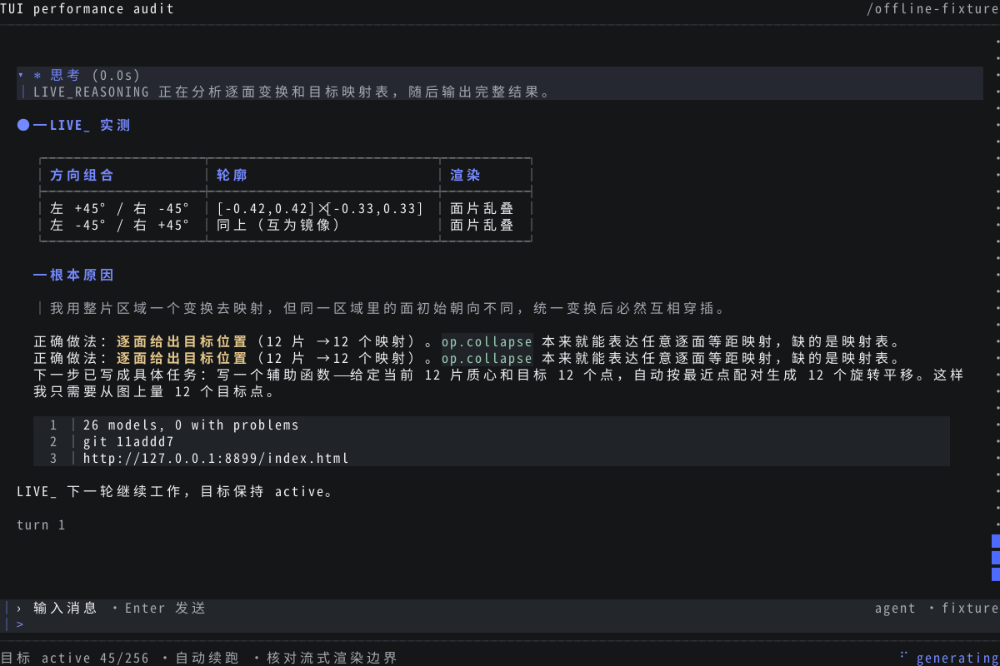
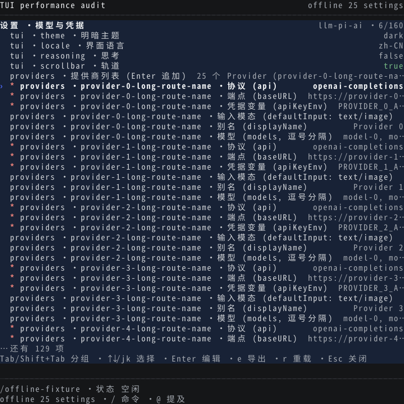

# TUI 性能、设置层级与流式残影分析

基线：`7952c5f3532770057945ef8a151d6d9e037d2cc3`，2026-10-21。

本文保留修复前的审计结论；后续实现、最终逐帧证据与性能对照见[修复验证](fix-verification.md)。

## 结论

当前问题涉及三个相互关联但需要分别验收的方面：

1. **滚轮手感有可复现的调度拖尾。** 默认一个滚轮报告对应 3 行，却按每帧 1 行追赶；距离超过 10 行时突然改成每帧 8 行。小幅滚动慢、大幅滚动突然加速，停手后仍在追赶。
2. **聊天区存在两个绘制者，已复现无操作时的重复文字残影。** Ink 的布局/增量输出和自定义绝对坐标覆盖同时写聊天区；覆盖层比较的是自身快照，无法知道 Ink 已经改写了它认为“未变化”的格子。
3. **settings 是扁平字段表，没有真正的多级浏览。** Tab 只是跳转选中行；Provider 的六个字段全部展开。长标签挤掉值，在窄屏还会折行，突破按条目数计算的高度预算。

优先级应当是：**绘制正确性 → 滚轮调度和帧合并 → settings 层级与编辑体验 → 长会话缓存/诊断优化。** 单独缩短定时器间隔会增加双重绘制和终端输出压力。

## 测量方法与边界

- 本机 Intel Core Ultra 5 225H、Node `v22.23.1`、Ink `7.1.1`、React `19.2.8`；生产 `TuiLoop`、`mountTuiRender`、鼠标解析、投影和终端输出适配器在 OS PTY 中运行。
- 会话、Provider 和服务快照为合成数据；没有调用模型、读取凭据或改变用户正在运行的 Goal。基准覆盖 500 / 2500 / 10000 条消息、简单文本、Markdown、持续输出，以及 40 / 80 / 120 / 200 列。
- 性能案例排除启动和初次投影；流式正确性案例检查捕获到的每个完成同步帧，包含初始输出和回合切换。
- 输入起点为进程收到 SGR 字节，输出终点为写出同步帧；不是显示器/GPU 真正呈现时刻。连续输入的“下一变化帧”不代表逐个输入已全部消费，故结论主要依据停手后追赶时间、输出量和最终位移。
- `NODE_ENV` 未设置，CPU profile 证实运行 React development 分支。绝对性能数字不能直接视作所有用户机器或 production 分支的结果。
- React `actualDuration` 只测 render 阶段，不含全部 Yoga、提交、ANSI 转换、终端解析和 GPU 绘制。RSS 包含 Node/依赖、源码执行和本次记录数组，不能直接视作产品最小内存需求或泄漏证明。
- 完整原始捕获和 CPU profile 留在 `/tmp/dsh-perf-audit/`；可长期保留的摘要、截图和逐帧证据在本目录 [evidence](./evidence)。

## 已验证：滚轮“粘手”

120×40、500 条普通消息，默认策略：

| 操作 | React commits | 实际位移帧 | 输出字节 | 输入结束至最后位移 |
| --- | ---: | ---: | ---: | ---: |
| 单个滚轮报告（3 行，5 次样本） | 每次 4 | 每次 3 | 20–26 KB | 48–56 ms |
| 同批 3 个报告（9 行） | 10 | 9 | 65.8 KB | 168 ms |
| 同批 10 个报告（30 行） | 5 | 4 | 27.8 KB | 74 ms |
| 同批 40 个报告（120 行） | 16 | 15 | 101.8 KB | 276 ms |
| 60 Hz 持续 1 秒，共 60 个报告 | 175 | 119 | 804.6 KB | 141 ms |

500、2500、10000 条消息的单批 9 行滚动都需要约 146–168 ms。这与 10 行加速阈值一致；不是只有长会话才发生。500 条和 2500 条会话的持续滚动追赶分别为 141、121 ms。

同一份代码，仅通过既有 render policy 在测试进程中将步长设为直接到目标，500 条消息的结果变为：

- 单个报告：每次约 24 ms 完成；同批 3 个报告：约 18 ms 完成。
- 60 Hz 持续滚动：118 次提交、478.5 KB 输出，停手后约 7 ms 完成。
- 输出量减少约 41%。此实验只证明调度对手感和绘制次数有显著影响；没有证明 CPU 一定降低，也不是建议把超大步长直接作为最终产品配置。

三个普通文本基准均接收全部 268 个滚轮报告，最终净位移与请求的 624 行相同。当前复现中没有丢失位移。

### 代码路径

`mouse-io.ts:472` 按一个 stdin chunk 合并报告并乘 `wheelRows=3`；`loop.tsx:2140` 为滚动设置 React state；`stream-view.tsx:2338` 先推进 scheduler 一次，再 `dispatchViewport`；`stream-view.tsx:1432` 每个仲裁帧继续 `dispatchViewport`。

随后 `StreamView` 更新可见切片、snapshot 和 JSX；`stream-view.tsx:2933` 仍用 `bottom={-effectiveOffset}` 移动 Yoga 布局；`stream-view.tsx:2627` 再通过 `writePublishedFrameSnapshot()` 输出覆盖层。

因此当前实现同时承担：输入触发父组件渲染、逐行子组件渲染/布局、Ink diff，以及覆盖层 diff。`mountTuiRender` 的 `maxFps` 约束 Ink，不能约束 layout effect 中直接写出的覆盖帧；60 Hz 输入案例实际记录了 119 个位移写帧。

默认调度见 `render-policy.ts:40–48` 和 `scroll-scheduler.ts:112–198`。问题包含一条不连续的速度曲线：9 行仍逐行追赶，而 30 行能以 8 行一步完成。

### 其他性能发现

- 120 列复杂 Markdown 会话的持续滚动输出达到约 1.20 MB；普通文本 80/120/200 列约为 0.68/0.80/0.98 MB。按坐标 diff 并不等于只写新进入视口的一行；滚动后大量屏幕坐标上的内容都发生变化。
- 普通静止聊天和 settings 的 0.5 秒空闲窗口均为 0 commits、0 输出字节。静态空闲循环不是本次主要瓶颈。
- 500 条消息边流式更新边滚动时，提交次数增至 270，React render p95 从普通滚动的约 2.94 ms 增至 6.09 ms。后台持续输出时的最后变化时间包含新内容，不能直接拿来计算滚动拖尾。
- CPU 采样中，除空闲样本后约 15.5% 落在 React `createElement` 自耗时，约 5.6% 在 ANSI tokenize、5.2% 在 string-width，另有 GC、ScreenAtlas、ANSI diff 和字符重组开销。它支持“调度之外还有渲染/字符处理成本”，不支持把问题全部归于网络或模型速度。
- 初次 React render 的样本：500 条约 166 ms，2500 条约 661 ms，10000 条约 5088 ms；10000 条进程首次 commit 在启动后约 19.3 秒。后一数字还包括模块加载和提交前工作，不能全部计入 React render。
- `transcript-line-store.ts:598` 每次预算检查遍历全部条目/行计算总量；`setPins()` 也触发该扫描。初始逐块 settle 又多次检查预算，存在近似二次增长路径。应维护增量计数、批量提交和有界的可见区预热。
- 缓存的 32 MiB 是 line-store 预算，不是进程内存上限。10000 条案例采样 RSS 约 450 MiB，包含其他投影缓存、源对象、依赖和审计开销；本次没有做泄漏判定。

## 已验证：无操作时的重复残影

用户补充：不滚动、不输入，只等待实时输出也会出现。为此新增“Markdown 每 20 ms 输出约 8 个字符，自动结算并开始下一回合”的场景，包含中文、表格、引用、代码块和推理区，并用 xterm 逐帧回放实际 PTY 字节。

| 终端尺寸 | 完成帧数 | 与发布 snapshot 内容不一致的帧 |
| --- | ---: | ---: |
| 120×40 | 470 | 7 |
| 80×24 | 503 | 7 |
| 108×48 | 426 | 7 |

三个尺寸共 1399 帧，21 帧有可核对的重复残留。比较包括短行/空行右侧应被清空的格子，不只比较文本前缀。



120×40 第 53 帧的证据：

1. 第 52 帧 snapshot 的第 22 行是空白；第 53 帧 snapshot 的第 22 行仍是空白。
2. 第 53 帧的 Ink 输出把“正确做法：逐面给出目标位置…”写进这一行。
3. `diffVisibleFrameSnapshots()` 只比较前后 snapshot，判定该行不变；覆盖序列中没有恢复第 22 行的正文区。
4. 第 21 行是正确的新文字，第 22 行残留一份同样文字。截图和原始帧字节均已保存。

相关边界在 `frame-fill.ts:278` 的 `transcriptOverlay()`、`frame-snapshot.ts:160` 的 snapshot diff、`stream-view.tsx:2612` 的发布，以及 Ink 实际写入后没有失效已绘制 snapshot 的路径。

这不是模型真的输出两份相同文本：用于比较的模型 snapshot 在残留位置明确为空白。它也不是 SGR 同步块缺失：常规流式/布局变化捕获中的同步开始、结束均配对。

**未验证：**本地已经复现重复残影，但尚未复现用户截图中完全相同的“正文穿到输入行下方”。不能据此宣称截图中的所有越界都由同一个分支造成。仍需在实际终端实例关联原始输出、当前几何和帧版本；还应检查 `frame-fill.ts:482–498` 的光标基线推断、输入/页脚高度切换、以及发布和 Ink flush 的先后关系。

当前的 `scrollInputToPaintMs` 也有观测缺口：起点在 viewport command 已进入组件之后，终点在 arbiter 发布时；它既遗漏前段排队，也没有等待实际输出完成。不能用该指标单独证明画面及时、正确地呈现。

## 已验证：settings 没有多级显示

`settings-groups.ts:18` 只计算下一组的第一个索引。`RuntimeController` 接到 `settings-group` 后只修改 `settingsSelectedIndex`；`SettingsPane` 仍从同一份 `rows` 中截取窗口，没有 group filter、展开状态、父节点、面包屑或返回栈。

`settingsRowsFromDescribe()` 遍历 namespace 顶层字段。Provider 被特别展开成 api、baseURL、apiKeyEnv、defaultInput、displayName、models 六行；其他 object/array 多数变成 JSON 字符串。官方 descriptor 的 schema、层级和字段说明没有被用于通用导航。

25 个合成 Provider、每个 65 个模型时：Provider 区为 152 行，加其他示例设置共 160 行。模型列表是逗号拼接的一行文本，没有下一层模型浏览。

| 宽度 | Provider 字段值显示空间为 0 的行数 | 标签本身超过行宽 |
| --- | ---: | ---: |
| 40 列 | 150 / 152 | 150 / 152 |
| 80 列 | 25 / 152 | 0 / 152 |
| 120 列 | 0 / 152 | 0 / 152 |

这些统计使用故意较长但合法的合成 Provider 名称，不代表用户配置中存在 25 个 Provider。



[40 列实测截图](./evidence/settings-40.png)已出现多行挤压和内容裁切。根因是 `settings-pane.tsx:156` 只限制 value，没有限制 label；`Text` 默认允许换行，`computeSettingsWindow()` 却把一个配置项当作一个物理行。`paintBackgroundRow()` 只补背景，不截断内容。

同时存在交互负担：

- 路径前缀反复出现，占据大量宽度，值和说明更难阅读。
- 缺少字段搜索、类型选择器、对象展开和独立模型列表。
- 一般字段提交成功后关闭整个 settings；重新打开会从索引 0 开始，不利于连续修改同一个 Provider。布尔/枚举的 Space 操作有单独的原地更新路径。
- `RuntimeController.emit()` 将所有面板、模型和 HUD snapshot 一起失效；修改选中项也经过 20 ms 的全局通知节流。这个 runtime 开销没有被合成 controller 的设置面板测量完整覆盖。
- 合成设置面板 30 个滚轮报告产生 60 次 React commit；小列表的 CPU 不是当前 settings 最严重的问题，结构和窄屏可用性更迫切。

建议的信息层级：

```text
设置
├─ 外观与输入
├─ 模型与凭据
│  ├─ Provider 列表（名称、状态、模型数）
│  │  └─ 某个 Provider
│  │     ├─ 连接配置（协议、端点、凭据引用）
│  │     ├─ 模型列表 → 某个模型的详情
│  │     └─ 高级配置
│  └─ 凭据管理
├─ Agent / 子代理
├─ 工具与运行环境
└─ 插件 / 其他扩展设置
```

宽屏可用分类/列表/详情分栏；窄屏使用逐级进入和返回。两种布局共享同一导航状态。对象/数组由官方 descriptor 驱动，未知字段提供通用树形或 JSON 编辑入口；更新仍走官方 `settings.update()`，凭据保持既有 credential 服务边界，保存时保留未知字段。

## 建议的实施顺序和验收标准

以下为待实施方案，不表示已修复。

| 顺序 | 改动 | 可验证的完成标准 |
| --- | --- | --- |
| P0 | 聊天区只保留一个绘制所有者；统一帧版本、几何、空行清理和光标状态 | 小片段 Markdown、自动下一回合、窗口变化、输入增高、HUD 切换时，每个完成帧都与规范 snapshot 一致；输入区和页脚无正文残留 |
| P1 | 鼠标位移按帧累加后直接呈现最新目标；将键盘步进与滚轮策略分开；稳定挂载窗口 | 本机基线下输入至写出 p95 ≤32 ms，停止后收敛 ≤32 ms；60/120 Hz 输入无位移损失、反向无继续旧方向的积压；总位移和帧数共同验收 |
| P1 | settings 分类 → 对象列表 → 详情 → 字段/模型；补搜索、返回和稳定选中项 | 40/80/120 列均能看到选中字段、值、错误和操作；长标签不会突破物理行预算；编辑后保留当前对象位置 |
| P2 | line-store 增量计数、批量预算检查、可见区优先投影，拆分 snapshot 失效范围 | 10k 消息首次进入可交互时间、峰值内存和单帧 CPU 有明确预算；滚动不随全部历史大小线性重扫 |
| P2 | 修正 latency 指标和性能门禁，区分 render/commit/write/drain/display | 自动报告输入积压、停手拖尾、字节率、提交数、帧一致性；不能仅凭平均 FPS 或 React render p95 判通过 |

现有 `openspec/changes/refine-tui-scroll-expand-and-visual-hierarchy/tasks.md` 将“滚动不逐帧 dispatchViewport”“TTY 不移动 Yoga bottom”等项标为完成，但当前源码仍保留这些行为。这些项需要按当前代码重新验收，不能沿用旧勾选作为性能证据。

## 复现与交付状态

```bash
# 在仓库根目录；开发依赖与源码类型链接采用既有 dev:setup。
python3 docs/performance-audit-2026-10-21/measure.py \
  --count 500 --output /tmp/dsh-perf-audit/repro-scroll

python3 docs/performance-audit-2026-10-21/measure.py \
  --scene live-markdown --count 100 --columns 120 --rows 40 \
  --output /tmp/dsh-perf-audit/repro-stream

node docs/performance-audit-2026-10-21/check-frames.mjs \
  /tmp/dsh-perf-audit/repro-stream/final.ansi \
  /tmp/dsh-perf-audit/repro-stream/frame-audit 120 40 \
  /tmp/dsh-perf-audit/repro-stream/raw.json
```

**已验证：**滚轮基准、默认策略与直接到目标的对照、三尺寸无操作流式残影、设置窄屏截图、CPU profile、全部四组严格类型检查。审计工具及汇总证据已落盘；本轮没有修改产品运行时代码。

**未验证：**实际用户终端里输入区越界的完整触发链、GPU 呈现延迟、production React 分支、真实模型输出速率及远端 SSH 链路。本报告没有把合成服务替代为真实认证/模型调用的证据。

**阻塞：**本轮分析无阻塞；产品修复尚未实施。输入区越界最终验收需要补齐用户实际运行实例的帧/几何证据。
